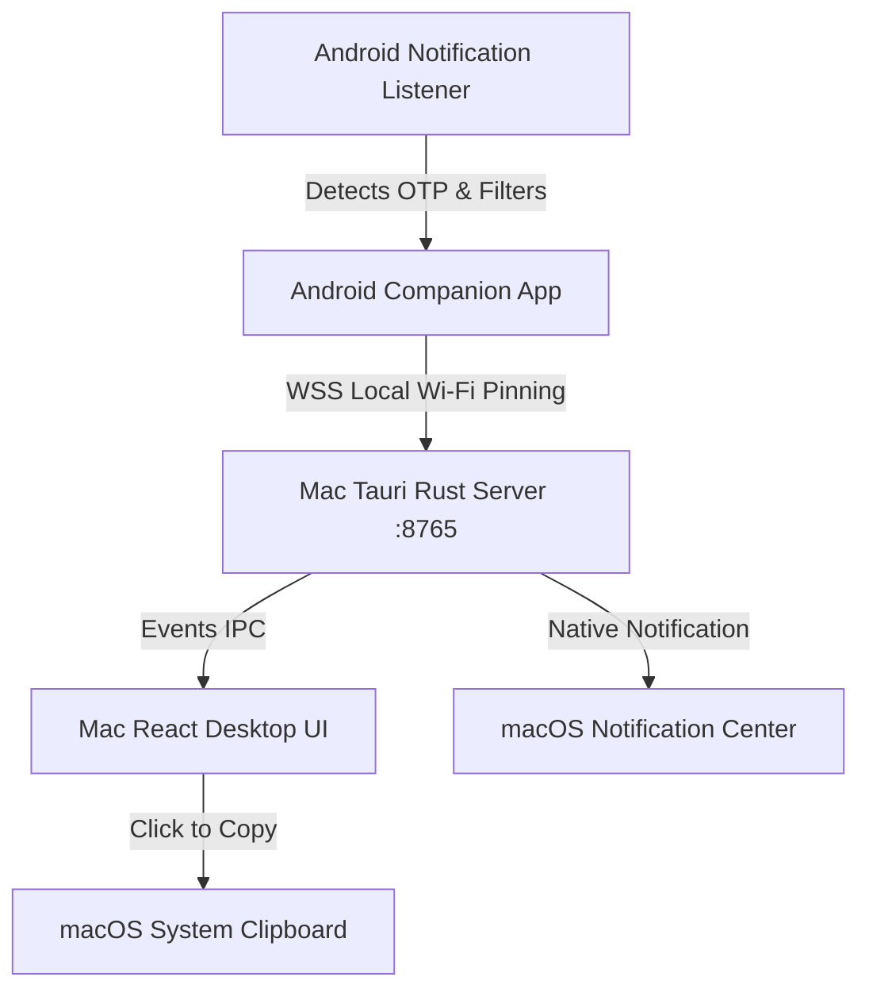

# DroidBridge Architecture

DroidBridge establishes a secure, local, peer-to-peer bridge over Wi-Fi between an Android device and a macOS desktop application.

## Security Model
- **TLS 1.3**: Ephemeral self-signed certificate on macOS, pinned via SHA-256 fingerprint inside the pairing QR code.
- **Challenge-Response**: Single-use 60s pairing challenge verified via HMAC-SHA256.
- **Keystore Backed**: Android pairing credentials stored securely in AndroidKeyStore using AES-GCM.
- **Privacy First**: OTPs kept strictly in-memory with automatic 60s expiration countdowns. No OTPs logged in plaintext.
